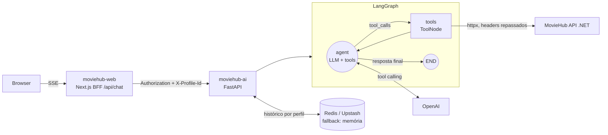

# 🤖 MovieHub AI

Assistente conversacional do **MovieHub**, um concierge de filmes e séries que conversa em português, consulta o catálogo de verdade, mexe na sua lista e até controla a interface do site.

Construído com **FastAPI + LangGraph + OpenAI (tool calling nativo)**, com respostas em **streaming (SSE)**.

> Faz parte do ecossistema MovieHub: [`moviehub-web`](https://github.com/gui-andreis/moviehub-web) (Next.js) · [`MovieHub`](https://github.com/gui-andreis/MovieHub) (API .NET) · **`moviehub-ai`**

---

## ✨ O que ele faz

| Pedido do usuário | O que acontece |
|---|---|
| "me recomenda um terror curto pra hoje" | busca com gênero + duração máxima e mostra os cards com pôster |
| "algo parecido com Interestelar" | acha o id, chama `get_similar` e explica por que combina |
| "eu curto terror, minha namorada comédia" | `group_pick` encontra títulos que agradam aos dois |
| "Duna ou Blade Runner 2049?" | `compare_titles` lado a lado, com veredito |
| "tenho 6h pra maratonar Dark" | `plan_marathon` monta a lista de episódios a partir de onde o perfil parou |
| "vale a pena? sem spoiler" | premissa, tom e para quem é, sem revelar a trama |
| "me faz uma pergunta sobre Matrix" | quiz de múltipla escolha com dados reais |
| "coloca na minha lista" / "amei esse" / "nota 9" | altera Minha Lista, a reação ou a review e atualiza a tela |
| "abre o trailer" / "me leva pros terrores mais bem avaliados" | emite `Action`s que o front executa |
| "como foi meu ano?" | retrospectiva com `get_my_stats` |

Também respeita o **perfil ativo**: em perfil infantil só recomenda títulos com classificação L/10, chama o usuário pelo nome e nunca dá spoiler sem avisar.

---

## 🏗️ Arquitetura



- **Agente ReAct**: o LLM decide sozinho quais tools usar e pode encadear várias (máx. `MAX_TOOL_ITERATIONS` rodadas). Ao atingir o limite, ele é obrigado a responder.
- **Contexto por requisição** (`ChatContext`) viaja em `config["configurable"]`. O token do usuário **nunca** passa pelo LLM.
- As tools **emitem eventos** (`titles`, `action`) via `adispatch_custom_event`, que viram eventos SSE em tempo real.
- **Memória**: só mensagens de texto user/assistant, chaveadas por `perfil + sessão`, com TTL de 24h e corte das últimas N mensagens. A resposta salva carrega uma nota interna com os ids dos títulos mostrados, para que "adiciona esse" funcione na mensagem seguinte.

```
app/
├── main.py                 # create_app(): CORS, handlers de erro, lifespan
├── config.py               # Settings (pydantic-settings)
├── api/
│   ├── routes.py           # /api/chat, /api/chat/stream, DELETE /api/chat/{id}
│   ├── schemas.py          # ChatRequest / ChatResponse (camelCase)
│   └── rate_limit.py       # janela deslizante por IP e sessão
├── agent/
│   ├── graph.py            # StateGraph agent ⇄ tools
│   ├── prompts.py          # persona + regras + contexto do perfil
│   ├── context.py          # ChatContext, emissão de cards/actions
│   └── tools/
│       ├── catalog.py      # tools públicas
│       ├── personal.py     # tools do perfil (login)
│       ├── ui.py           # tools de interface (Actions)
│       └── fun.py          # maratona, comparação, escolha em grupo
├── clients/moviehub.py     # httpx + envelope {status,message,data} + erros tipados
├── memory/store.py         # Redis (redis:// e rediss://) + fallback em memória
└── services/chat.py        # roda o grafo e traduz para eventos SSE
```

---

## 🧰 Tools

**Catálogo (públicas):** `search_titles` (texto, tipo, gêneros por nome, ano, nota, streaming, classificação, idioma, duração máx., ordenação) · `get_title_details` · `get_similar` · `get_trending` · `get_top10` · `get_upcoming` · `random_pick` · `list_genres` · `list_providers` · `get_person` · `get_collection` · `get_season_episodes` · `get_reviews_summary`

**Pessoais (login + perfil):** `get_my_list` · `add_to_my_list` · `remove_from_my_list` · `react_to_title` · `get_continue_watching` · `write_review` (cria ou atualiza) · `get_my_reviews` · `get_my_stats`

**Interface (emitem Actions):** `navigate` · `open_title` · `play_trailer` · `play_title` · `set_filters` · `refresh_view` · `show_toast` · `suggest_followups`

**Compostas:** `plan_marathon` · `compare_titles` · `group_pick`

Erros da API viram mensagens amigáveis: 401 vira `LOGIN_REQUIRED`, 404/409 usam a mensagem da API, timeout e conexão viram "MovieHub indisponível".

---

## 📡 Endpoints

| Método | Rota | Descrição |
|---|---|---|
| POST | `/api/chat` | resposta completa (JSON) |
| POST | `/api/chat/stream` | resposta em **SSE** |
| DELETE | `/api/chat/{sessionId}` | limpa o histórico da sessão (do perfil atual) |
| GET | `/health` | `{"status":"ok"}` |
| GET | `/docs` | Swagger |

Headers opcionais repassados para a API: `Authorization: Bearer <jwt>` e `X-Profile-Id: <guid>`.

**Request**
```json
{ "message": "me recomenda um terror curto", "sessionId": "web-3f2a" }
```

**Response (`/api/chat`)**
```json
{
  "reply": "Bora de susto rápido! **Hereditário** (2018) ⭐ 7.3 …",
  "sessionId": "web-3f2a",
  "titles": [{ "id": 12, "type": "movie", "name": "Hereditário", "posterUrl": "…", "…": "…" }],
  "actions": [{ "type": "open_title", "titleId": 12 }],
  "suggestions": ["Algo menos pesado", "Coloca na minha lista"]
}
```

### Protocolo SSE (`/api/chat/stream`)

```
event: tool
data: {"name":"search_titles","status":"start","label":"Procurando no catálogo…"}

event: titles
data: [{"id":12,"type":"movie","name":"Hereditário", ...}]

event: tool
data: {"name":"search_titles","status":"end","label":"Procurando no catálogo…"}

event: action
data: {"type":"open_title","titleId":12}

event: token
data: {"text":"Bora de susto "}

event: done
data: {"reply":"…","sessionId":"web-3f2a","titles":[…],"actions":[…],"suggestions":[…]}
```

| Evento | Payload |
|---|---|
| `token` | `{ text }`, pedaço da resposta (concatene) |
| `tool` | `{ name, status: start\|end, label }`, para mostrar o "pensando…" |
| `titles` | `TitleCard[]`, cards novos para renderizar |
| `action` | `Action`, para o front executar |
| `done` | payload final; `reply` é a versão canônica do texto |
| `error` | `{ message, status }`, sempre o último evento quando algo falha |

`Action`: `navigate {path}` · `open_title {titleId}` · `play_trailer {titleId}` · `play {titleId}` · `refresh {target: my-list|reactions|reviews|progress}` · `set_filters {path, query}` · `toast {message}`

---

## ⚙️ Variáveis de ambiente

| Variável | Padrão | Descrição |
|---|---|---|
| `OPENAI_API_KEY` | — | chave da OpenAI (sem ela o serviço sobe, mas o chat responde 503 com uma mensagem clara) |
| `OPENAI_MODEL` | `gpt-4.1-mini` | modelo com suporte a tool calling |
| `MOVIEHUB_API_URL` | `http://localhost:5000` | URL da API .NET (aceita também `MOVIEHUB_BASE_URL`) |
| `REDIS_URL` | vazio | `redis://` ou `rediss://` (Upstash); vazio = memória local |
| `ALLOWED_ORIGINS` | `http://localhost:3000` | CSV de origens CORS |
| `PORT` | `8000` | porta HTTP (o Render injeta automaticamente) |
| `MAX_TOOL_ITERATIONS` | `6` | rodadas máximas de tools por mensagem |
| `HISTORY_MAX_MESSAGES` | `20` | mensagens mantidas por sessão |
| `RATE_LIMIT_PER_MINUTE` | `20` | por IP e por sessão |

---

## 🚀 Rodando localmente

Pré-requisitos: Python 3.11+, a MovieHub API rodando em `http://localhost:5000` e uma chave da OpenAI.

```bash
cp .env.example .env            # preencha OPENAI_API_KEY
python -m venv .venv
# Windows: .venv\Scripts\activate   |   Linux/macOS: source .venv/bin/activate
pip install -e ".[dev]"
uvicorn app.main:app --reload --port 8000
```

Swagger em http://localhost:8000/docs. Para testar o streaming:

```bash
curl -N -X POST http://localhost:8000/api/chat/stream \
  -H "Content-Type: application/json" \
  -d '{"message":"o que está em alta?","sessionId":"teste"}'
```

### Com Docker

```bash
docker compose up --build       # IA em :8000 + Redis em :6380
```

O container aponta para a API em `http://host.docker.internal:5000`. Para mudar, use `MOVIEHUB_API_URL_DOCKER`.

---

## 🧪 Testes

```bash
pytest -q
```

São 23 testes, todos sem rede: a API é mockada com **respx** e o LLM com um modelo fake que devolve `tool_calls` roteirizados. Eles cobrem:

- repasse de `Authorization` e `X-Profile-Id`, resolução de gêneros por nome e filtro de duração
- mapeamento de erros (401, 404, 5xx, timeout, conexão) e bloqueio de tools pessoais sem login
- emissão de cards e Actions (lista, reação, review com upsert, navegação, filtros)
- `plan_marathon` e `group_pick`
- formato e ordem dos eventos SSE, `/api/chat`, histórico por perfil, `DELETE`
- erro limpo sem chave ou com chave inválida da OpenAI, limite de iterações, rate limit, validação e prompt de perfil infantil

---

## ☁️ Deploy no Render

1. Em **New → Blueprint**, aponte para este repositório (o `render.yaml` já define o serviço Docker com health check em `/health`).
2. Preencha as variáveis marcadas como `sync: false`:
   - `OPENAI_API_KEY`
   - `MOVIEHUB_API_URL`, por exemplo `https://moviehub-api.onrender.com`
   - `REDIS_URL`: crie um Redis grátis no [Upstash](https://upstash.com) e copie a URL `rediss://…`
   - `ALLOWED_ORIGINS`, por exemplo `https://seu-app.vercel.app`
3. Deploy. Na Vercel, configure `MOVIEHUB_AI_URL=https://moviehub-ai.onrender.com` no front.

> No plano free, o Render hiberna o serviço depois de 15 min sem uso, e a primeira mensagem pode demorar ~30s.

---

## 👨‍💻 Autor

Feito por **Guilherme Andreis**
[LinkedIn](https://www.linkedin.com/in/guilherme-boeira-andreis) · [GitHub](https://github.com/gui-andreis)
